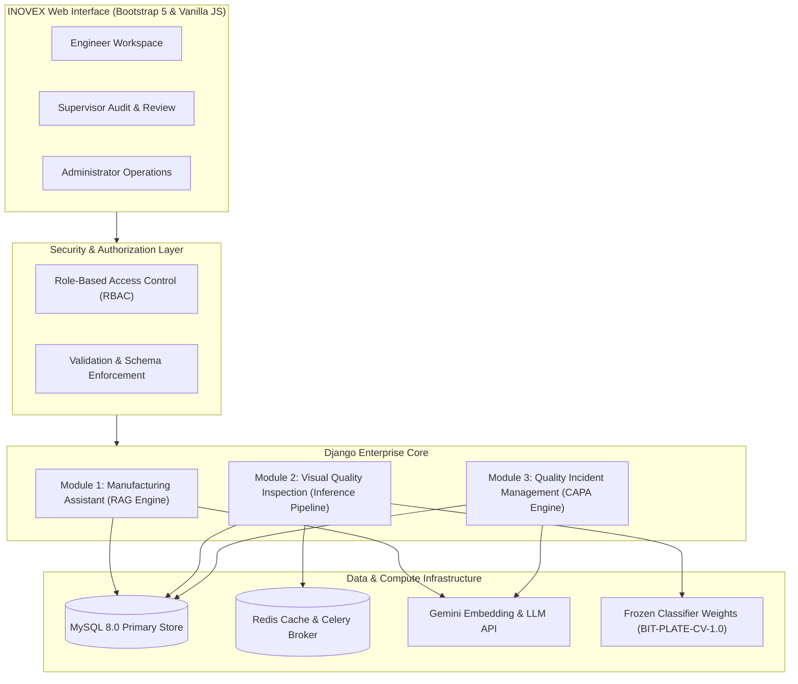

# INOVEX — AI-Powered Manufacturing Intelligence Platform

> **Intelligent Manufacturing. Assured Quality.**

[](https://www.python.org/)
[](https://www.djangoproject.com/)
[](https://www.django-rest-framework.org/)
[](https://www.mysql.com/)
[](https://redis.io/)
[](#module-2-visual-quality-inspection)
[](#automated-testing--benchmarks)

INOVEX is an enterprise-grade industrial software platform designed to unify manufacturing floor intelligence, automated visual quality inspection, and closed-loop corrective action management. Built for modern high-reliability manufacturing facilities, INOVEX enforces strict domain isolation, deterministic citation grounding, and immutable audit trails.

---

## Architecture Overview



---

## Integrated Modules

### Module 1: Manufacturing Assistant
* **Strictly Grounded RAG:** Ingests complex technical manuals (`HP-OPS-01`, `HP-MNT-01`, `AC-OM-01`) using PyMuPDF with exact 1-based page coordinates.
* **Equipment Isolation:** Questions are strictly bound to the target machinery, preventing catastrophic cross-asset information leakage.
* **Semantic Alarm Disambiguation:** Resolves overloaded industrial alarm codes (e.g., distinguishing HP-200 hydraulic pressure `E17` from AC-90 discharge temperature `E17`).
* **Audit-Ready Documentation:** Produces exportable PDF incident reports citing exact manual sections, revisions, and passage text.

### Module 2: Visual Quality Inspection
* **Automated Defect Classification:** Integrates the pre-trained `BIT-PLATE-CV-1.0` computer vision classifier to evaluate metal plate surface integrity.
* **Deterministic Inference:** Applies normalized feature extraction with a fixed `0.5` decision threshold to classify parts into **Normal** or **Defective**.
* **High-Throughput Batch Processing:** Asynchronous batch intake powered by Celery and Redis with granular per-image failure resilience.
* **Zero False Negative Notice:** Evaluated against 60 standardized test plates with built-in scientific cautions regarding synthetic dataset variance versus live factory floor lighting and noise.

### Module 3: Quality Incident Management
* **Closed-Loop CAPA Workflow:** Automatically binds defective inspection findings to structured Quality Incidents under an enforced 1-to-1 database constraint.
* **SOP Grounding Engine:** Maps product categories to authorized Standard Operating Procedures (`SOP-QC-001`, `SOP-QC-002`, `SOP-APP-001`) with passage-verified corrective steps.
* **Supervisor Adjudication:** Enforces multi-tier human review with explicit statuses: `Approved for follow-up` or `Needs more information`. Insufficiently grounded actions are automatically blocked from approval.

---

## Role-Based Access Control (RBAC)

INOVEX enforces multi-tier security at the Django middleware and view levels, preventing URL tampering or unauthorized role escalation:

| Capability | Engineer | Supervisor | Administrator |
| :--- | :---: | :---: | :---: |
| Self-Registration (Default Role) | Yes | No (Admin provisioned) | No (Admin provisioned) |
| Query Manufacturing Assistant | Yes | Audit Log Only | Yes |
| Single & Batch Visual Inspection | Yes | No | No |
| Personal Inspection History | Yes (Own only) | No | No |
| Inspect Any Inspection Detail | Own | Yes | Yes |
| Adjudicate Quality Reviews | No | Yes | View Only |
| Model Performance Benchmark | No | Yes | Yes |
| Product & Machinery Registry | No | No | Full Control |

---

## Technology Stack

* **Backend:** Python 3.14, Django 6.1.2, Django REST Framework
* **Frontend:** Responsive HTML5, Bootstrap 5.3.3, Bootstrap Icons, Custom Industrial Enterprise CSS
* **Database:** MySQL 8.0 with InnoDB engine and PyMySQL connector
* **Asynchronous Queue:** Celery 5.4 with Redis broker and result backend
* **Document Intelligence:** PyMuPDF (`fitz`), Gemini Embeddings (`gemini-embedding-001`), Gemini Flash
* **Computer Vision:** NumPy, SciPy, Pillow, Custom Neural Classifier (`classifier.npz`)
* **Document Generation:** ReportLab Enterprise PDF generation

---

## Getting Started

### Prerequisites
* Python 3.14+
* MySQL 8.0+ running on `127.0.0.1:3306`
* Redis running on `127.0.0.1:6379`
* Gemini API Key

### Installation

1. **Clone the Repository:**
   ```bash
   git clone https://github.com/your-username/inovex-platform.git
   cd inovex-platform
   ```

2. **Configure Environment:**
   Copy the template and supply your local configuration:
   ```bash
   cp .env.example .env
   ```

3. **Install Dependencies:**
   ```bash
   python -m venv venv
   source venv/bin/activate  # On Windows: .\venv\Scripts\activate
   pip install -r requirements.txt
   ```

4. **Run Database Migrations & Initial Setup (Local Development / Testing Only):**
   ```bash
   python manage.py migrate
   python manage.py seed_data      # Seeds local test fixtures, machines, and local test accounts
   python manage.py seed_product   # Seeds demonstration product line (P-PLATE01)
   ```

   > **Security Notice:** The `seed_data` command is strictly intended for local development, evaluation, and test environments. It provisions local demonstration accounts (`admin`, `engineer`, `supervisor`). Passwords can be configured locally via environment variables (`SEED_ADMIN_PASSWORD`, `SEED_ENGINEER_PASSWORD`, `SEED_SUPERVISOR_PASSWORD`); if not set, high-entropy random passwords are automatically generated and displayed only in the local terminal. **Do not execute `seed_data` in production environments.** For production deployments, provision administrative accounts securely using `python manage.py createsuperuser` and enforce unique, high-entropy credentials.

5. **Start Redis Server & Celery Worker (Optional for async batching):**
   ```bash
   # In terminal 1:
   redis-server

   # In terminal 2:
   celery -A config worker --pool=solo --loglevel=info
   ```

6. **Launch Development Server:**
   ```bash
   python manage.py runserver 127.0.0.1:8000
   ```
   Navigate to `http://127.0.0.1:8000/` in your browser.

---

## Automated Testing & Benchmarks

The INOVEX platform includes a comprehensive 102-test regression and validation suite covering security boundaries, RAG disambiguation, visual classification, and incident workflows:

```bash
python manage.py test assistant products inspections incidents --noinput
```

### Test Suite Distribution (102 Tests)
* **`assistant` (10 tests):** Machine isolation, semantic alarm disambiguation (E17, E31), multi-manual synthesis, unsupported queries, citation validation.
* **`products` (20 tests):** Registry lifecycle, duplicate validation, active/inactive toggles, foreign key protections.
* **`inspections` (48 tests):** File integrity validation, single/batch inference pipelines, supervisor review adjudication, role access controls.
* **`incidents` (24 tests):** SOP mapping coverage, 1-to-1 inspection-incident enforcement, decision state transitions, citation consistency.

---

## License & Attribution

Designed and engineered as an enterprise-grade industrial software showcase. Distributed under the MIT License.
